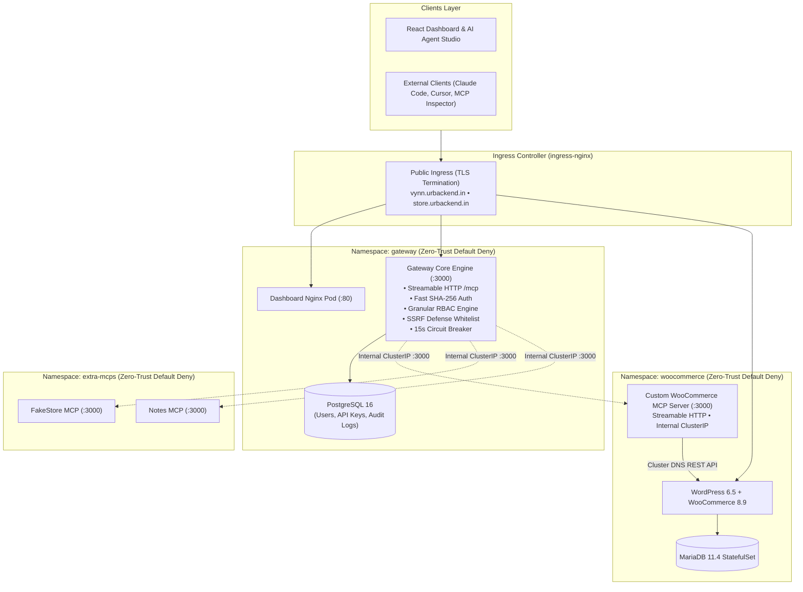

# Urumi MCP Gateway Platform (Kubernetes)

An enterprise Kubernetes-native hosting platform and Model Context Protocol (MCP) Gateway that aggregates multiple upstream MCP servers behind a single authenticated Streamable HTTP endpoint (`/mcp`), paired with a React console, real-time audit logging, and an autonomous LLM chat agent.

```
                      +------------------------------------------+
                      |         Urumi MCP Gateway Hub            |
                      |  Single Streamable HTTP Endpoint (/mcp)  |
                      +--------------------+---------------------+
                                           |
                +--------------------------+--------------------------+
                |                          |                          |
                v                          v                          v
      [ WooCommerce MCP ]          [ FakeStore MCP ]            [ Notes MCP ]
      WordPress REST API           Catalog Tools                Team Scratchpad
      (ClusterIP Internal)         (Catalog API)                (Local Memory)
```

---

## Live Production Deployment (AWS EC2 K3s)

The entire platform is deployed live on a single-node AWS EC2 production Kubernetes (K3s) cluster:
- **Web Console & AI Agent:** [https://vynn.urbackend.in](https://vynn.urbackend.in)
- **WooCommerce Storefront:** [https://store.urbackend.in](https://store.urbackend.in)
- **Streamable HTTP MCP Endpoint:** `https://vynn.urbackend.in/mcp`

---

## Standout Features Implemented (Beyond Core Requirements)

1. **Production VPS & Cloud Portability (Standout #1):**
   - Packaged and deployed via Helm on **AWS EC2 (Ubuntu 24.04 LTS, K3s single-node cluster)**.
   - Pinned to custom domain `urbackend.in` using Ingress-Nginx with zero code modifications between local and production.
2. **Granular Tool Permissions & RBAC (Standout #2):**
   - **Admin vs. Member Separation:** Admins possess unrestricted access to all 17 tools (including product creation, status mutation, note deletion).
   - Regular **Members** are restricted strictly to safe query/read tools (`list_products`, `get_product`, `list_orders`, `get_order`, `list_customers`, `list_notes`, `get_note`, `fakestore_*`).
   - Mutating tools are dynamically stripped from `tools/list` for members and return **403 Forbidden** (`RBAC_PERMISSION_DENIED`) if invoked directly.
3. **Enterprise Security Hardening (Standout #6):**
   - **SSRF Defense Engine:** Validates all registered URLs against in-cluster whitelists and rejects RFC1918 private subnets, loopback, and cloud metadata (`169.254.169.254`).
   - **At-Rest AES-256-GCM Encryption:** Upstream credentials encrypted in PostgreSQL; zero credential leakage to clients or browser.
   - **Zero-Trust NetworkPolicies:** Default-deny ingress across all 3 namespaces with micro-segmented pinholes. Upstream MCP servers and databases run as private ClusterIPs with zero public Ingress.
   - **Fast Indexed SHA-256 API Keys:** Machine-to-machine tokens (`mcp_live_<hex>`) authenticated via indexed SHA-256 hash queries.
   - **Non-root containers:** the upstream MCP servers run as non-root; gateway, dashboard and PostgreSQL still use image defaults (see `docs/threat-model.md`).
4. **OAuth on the Gateway (Standout #3):**
   - MCP-spec OAuth 2.1 authorization server: RFC 9728 protected-resource metadata, RFC 8414 server metadata, RFC 7591 dynamic client registration, PKCE, refresh tokens (`apps/gateway/src/routes/oauth.ts`, `apps/gateway/src/services/oauthService.ts`).
   - Claude / ChatGPT connectors log in via browser; granted scopes are capped by the user's role (members get `mcp:read` only).
5. **Deep Observability & Telemetry (Standout #8):**
   - Prometheus metrics for tool calls, error rate, latency and timeouts per server (`apps/gateway/src/services/metrics.ts`), dashboard Observability view, per-tool latency, input/output inspector and health monitor.
6. **Upgrades & Rollback (Standout #9):**
   - Documented Helm revision-based upgrade and rollback flow — see [Upgrades & Rollback](#upgrades--rollback-helm).

---

## Key Features

- **Centralized MCP Aggregation:** Connects multiple upstream MCP servers once; team members access all tools through a single URL (`https://vynn.urbackend.in/mcp` or `https://dashboard.localtest.me/mcp`) using personal API keys.
- **Deterministic Namespacing:** Resolves tool collisions deterministically using `{server_slug}__{tool_name}` (e.g. `woocommerce__list_products`, `fakestore__get_product`, `notes__create_note`).
- **Autonomous AI Agent Studio:** Multi-turn tool execution loop powered by official OpenAI SDK with multi-provider dynamic routing (OpenAI, Gemini, Groq, Ollama), rendering live Markdown and tool execution timelines.
- **Micro-Segmented Security:** Strict Kubernetes NetworkPolicies enforce default-deny ingress and zero-trust pinhole communication between microservices.
- **Fast Indexed Authentication:** $O(1)$ token authentication with indexed SHA-256 hashes (`mcp_live_<hex>`) and instant cryptographic revocation.
- **Zero Credential Leakage:** Upstream WooCommerce REST credentials are encrypted with AES-256-GCM and never exposed to clients or browser frontends.
- **100% Helm-Native:** Fully portable across local development (`k3d` / `Kind`) and production VPS (`k3s`) with configuration-only changes via `helm/values-local.yaml` and `helm/values-aws.yaml`.

---

## System Architecture



| Namespace | Workload | Type | Purpose |
| :--- | :--- | :--- | :--- |
| `woocommerce` | `wordpress` | Deployment (Apache) | WooCommerce storefront & WP-Admin (`store.localtest.me`) |
| `woocommerce` | `mariadb` | StatefulSet (11.4) | WordPress relational database with PVC |
| `woocommerce` | `woocommerce-mcp` | Deployment | Custom Streamable HTTP MCP server (Internal ClusterIP :3000) |
| `extra-mcps` | `fakestore-mcp` | Deployment | Secondary MCP upstream wrapping public catalog API |
| `extra-mcps` | `notes-mcp` | Deployment | Tertiary MCP upstream providing team note management |
| `gateway` | `gateway` | Deployment (Express) | MCP client/server aggregator, REST API, Auth & Audit engine |
| `gateway` | `postgres` | StatefulSet (16) | Gateway database (users, keys, servers, audit logs) with PVC |
| `gateway` | `dashboard` | Deployment (Nginx) | React + Tailwind console (`dashboard.localtest.me`) |

For comprehensive architecture diagrams and routing details, see [System Design](docs/system-design.md).  
For security perimeters, SSRF defense, and threat analysis, see [Threat Model](docs/threat-model.md).

---

## Quickstart: Local Reproduction Guide

### 1. Prerequisites
- Docker Desktop (running)
- `k3d` (v5.x+)
- `kubectl`
- `helm` (v3.x+)
- `pnpm` (v9.x+)

### 2. Bootstrap Local Cluster
Create the local `k3d` cluster mapping ports 80 and 443 with Traefik disabled:

```bash
k3d cluster create mcp-cluster --port "80:80@loadbalancer" --port "443:443@loadbalancer" --k3s-arg "--disable=traefik@server:0"
```

Install the Nginx Ingress Controller:
```bash
helm repo add ingress-nginx https://kubernetes.github.io/ingress-nginx
helm repo update
helm install ingress-nginx ingress-nginx/ingress-nginx -n ingress-nginx --create-namespace
```

Create cluster namespaces:
```bash
kubectl apply -f k8s/namespaces.yaml
```

### 3. Build & Import Container Images
Build the container images locally and import them into the `k3d` cluster:

```bash
# Gateway Backend
docker build -t mcp-platform/gateway:v1.0.2 apps/gateway
k3d image import mcp-platform/gateway:v1.0.2 -c mcp-cluster

# React Dashboard
pnpm --filter @mcp-platform/dashboard build
docker build -f apps/dashboard/Dockerfile -t mcp-platform/dashboard:v1.0.3 .
k3d image import mcp-platform/dashboard:v1.0.3 -c mcp-cluster

# WooCommerce MCP Server
docker build -t mcp-platform/woocommerce-mcp:latest apps/woocommerce-mcp
k3d image import mcp-platform/woocommerce-mcp:latest -c mcp-cluster

# Secondary MCP Servers
docker build -t mcp-platform/fakestore-mcp:latest apps/fakestore-mcp
docker build -t mcp-platform/notes-mcp:latest apps/notes-mcp
k3d image import mcp-platform/fakestore-mcp:latest -c mcp-cluster
k3d image import mcp-platform/notes-mcp:latest -c mcp-cluster
```

### 4. Deploy via Helm
Deploy all platform components using the local values configuration:

```bash
# 1. WooCommerce Storefront, Database & Custom MCP
helm upgrade --install woocommerce-store helm/charts/woocommerce-store -n woocommerce -f helm/values-local.yaml

# 2. Secondary Upstream MCPs
helm upgrade --install extra-mcps helm/charts/extra-mcps -n extra-mcps -f helm/values-local.yaml

# 3. Gateway, Dashboard & PostgreSQL
helm upgrade --install gateway helm/charts/gateway -n gateway -f helm/values-local.yaml
```

### 5. Apply Zero-Trust Network Policies
Enforce default-deny ingress and inter-service isolation:

```bash
kubectl apply -f k8s/network-policies.yaml
```

### 6. Configure Local DNS & OpenAI Key
The domain suffix `*.localtest.me` automatically resolves to `127.0.0.1` on all operating systems without editing `/etc/hosts`.

To enable the AI Chat Agent, pass your LLM API key through Helm so it lands in the `gateway-secrets` Kubernetes Secret (never in source or a plain env var):
```bash
helm upgrade --install gateway helm/charts/gateway -n gateway -f helm/values-local.yaml \
  --set gateway.env.openaiApiKey="$OPENAI_API_KEY" --set gateway.env.openaiModel="gpt-4o-mini"
```
`gateway.env.geminiApiKey` and `gateway.env.groqApiKey` work the same way for the other supported providers.

---

## Accessing the Platform

### 1. Web Console & Agent Studio
- **URL:** [https://dashboard.localtest.me](https://dashboard.localtest.me) (or `http://dashboard.localtest.me`)
- **Default Admin Login:**
  - **Email:** `admin@mcp-platform.local`
  - **Password:** `AdminPass123!`

### 2. WooCommerce Storefront & Admin
- **Storefront:** [https://store.localtest.me](https://store.localtest.me)
- **WP-Admin:** [https://store.localtest.me/wp-admin](https://store.localtest.me/wp-admin)
  - **Username:** `admin`
  - **Password:** `AdminSecurePassword123!`

---

## Verification & Definition of Done Scenarios

### Scenario A: Storefront Checkout
1. Visit `https://store.localtest.me`.
2. Add a product to your cart and proceed to checkout.
3. Select **Cash on Delivery (COD)** and place the order.
4. Verify the order appears in WP-Admin (`WooCommerce > Orders`).

### Scenario B: AI Agent Autonomous Tool Calling
1. Open the **AI Agent** tab in the Dashboard.
2. Ask: *"What products are currently available in the WooCommerce store?"*
   - Agent invokes `woocommerce__list_products` and displays formatted product details.
3. Ask: *"Create a new product named 'Urumi Pro Hoodie' with price 59.99"*
   - Agent invokes `woocommerce__create_product`.
4. Refresh `https://store.localtest.me` to confirm the product renders live on the storefront.

### Scenario C: External MCP Client (Claude Code / Cursor)
Connect any standard MCP client using Streamable HTTP:
- **Server URL:** `https://dashboard.localtest.me/mcp`
- **Headers:** `Authorization: Bearer mcp_live_<your_key>`
- Execute multi-server queries querying WooCommerce orders alongside team notes in a single prompt.

Claude Code example:
```bash
claude mcp add --transport http mcp-gateway https://dashboard.localtest.me/mcp --header "Authorization: Bearer mcp_live_<your_key>"
```
MCP Inspector: `npx @modelcontextprotocol/inspector`, choose **Streamable HTTP**, enter the URL above and add the same `Authorization` header.

Members only see read-only tools, so for user B use a read-only cross-server prompt, e.g. *"List today's WooCommerce orders and the FakeStore product categories."*

### Scenario D: Governance & Failure Containment
1. **API Key Revocation:** Revoke an active key in the dashboard; subsequent tool requests immediately fail with HTTP 401 and log an unauthorized event in the audit trail.
2. **Disable an Upstream:** Toggle a server off in **Servers**. Its tools disappear immediately from `tools/list` for external clients and from the chat agent; direct calls return `Server "<slug>" is currently disabled`.
3. **Server Outage Isolation:** Kill an upstream MCP server pod (`kubectl delete pod ... -n extra-mcps`). The dashboard marks the server as `Unreachable`, while WooCommerce and Notes servers continue operating with zero downtime.

---

## Production Deployment (k3s VPS)

To deploy to a production Linux VPS running k3s:
1. Ensure `k3s` is installed with standard Traefik disabled or configure Ingress-Nginx.
2. Point your DNS records (`store.yourdomain.com`, `dashboard.yourdomain.com`) to the VPS public IP.
3. Deploy using `helm/values-prod.yaml`:
   ```bash
   helm upgrade --install woocommerce-store helm/charts/woocommerce-store -n woocommerce -f helm/values-prod.yaml
   helm upgrade --install extra-mcps helm/charts/extra-mcps -n extra-mcps -f helm/values-prod.yaml
   helm upgrade --install gateway helm/charts/gateway -n gateway -f helm/values-prod.yaml
   ```

The live deployment at `urbackend.in` uses `helm/values-aws.yaml` (an AWS EC2 k3s variant of `values-prod.yaml`; secret values in it are placeholders) and is built and deployed by `deploy-aws.sh`.

---

## Upgrades & Rollback (Helm)

Every `helm upgrade` creates a new numbered release revision, so any component can be upgraded or rolled back on its own.

**Upgrade** (e.g. a new gateway image): build and import the new tag, bump `gateway.image.tag` in the values file, then:
```bash
helm upgrade gateway helm/charts/gateway -n gateway -f helm/values-prod.yaml
kubectl rollout status deployment/gateway -n gateway
```
Deployments use rolling updates; readiness probes keep traffic on the old pod until the new one is ready. The same pattern applies to `woocommerce-store` (WordPress/MCP image tags) and `extra-mcps`.

**Rollback**:
```bash
helm history gateway -n gateway        # list revisions
helm rollback gateway <REVISION> -n gateway
kubectl rollout status deployment/gateway -n gateway
```

**Data safety**: rollbacks only change Kubernetes manifests; PVCs (MariaDB, WordPress, PostgreSQL) are kept. Prisma migrations are forward-only, so take a `pg_dump` before upgrades that include schema migrations, and a `mariadb-dump` before upgrading WordPress/WooCommerce.
