# System Design & Architecture Specification

## 1. Executive Overview
The **Urumi MCP Gateway Platform** is an enterprise-grade, Kubernetes-native integration platform designed to bridge autonomous AI agents with distributed internal and third-party systems. Built on the open **Model Context Protocol (MCP)**, the platform aggregates disparate upstream MCP servers behind a single, authenticated Streamable HTTP endpoint (`/mcp`) while maintaining multi-tenant isolation, comprehensive audit trails, and strict zero-trust network boundaries.

```
+--------------------------------------------------------------------------------------------------+
|                                    PUBLIC INGRESS / INTERNET                                     |
+--------------------------------------------------------------------------------------------------+
               | (HTTPS 443 / HTTP 80)                                    | (HTTPS 443 / HTTP 80)
               v                                                          v
   +-----------------------+                                  +-----------------------+
   |   store.localtest.me  |                                  | dashboard.localtest.me|
   +-----------------------+                                  +-----------------------+
               |                                                          |
               v                                                          v
    [ Ingress Controller ]                                     [ Ingress Controller ]
               |                                                          |
               |                                               +----------+----------+
               |                                               |                     |
               v                                               v                     v
   +-----------------------+                       +-----------------------+ +-----------------------+
   |  WordPress 6.5 Apache |                       |  Dashboard Frontend   | |    Gateway Engine     |
   | (woocommerce ns)      |                       |  (Nginx SPA Proxy)    | |    (Express + SSE)    |
   +-----------------------+                       +-----------------------+ +-----------------------+
               |                                                                     |
               +-----------------------------+                                       |
                                             v                                       v
                                 +-----------------------+               +-----------------------+
                                 |    MariaDB 11.4       |               |    PostgreSQL 16      |
                                 |    (StatefulSet)      |               |    (StatefulSet)      |
                                 +-----------------------+               +-----------------------+
                                             ^                                       |
                                             | (REST API via cluster DNS)            |
                                 +-----------------------+                           |
                                 |  woocommerce-mcp      |<--------------------------+ (Internal ClusterIP)
                                 |  (ClusterIP Port 3000)|                           |
                                 +-----------------------+                           |
                                                                                     |
                                 +-----------------------+                           |
                                 |  fakestore-mcp        |<--------------------------+
                                 |  (extra-mcps ns)      |                           |
                                 +-----------------------+                           |
                                                                                     |
                                 +-----------------------+                           |
                                 |  notes-mcp            |<--------------------------+
                                 |  (extra-mcps ns)      |
                                 +-----------------------+
```

---

## 2. Core Architectural Components

### 2.1 WooCommerce Storefront Layer (`woocommerce` Namespace)
- **Engine:** WordPress 6.5 (Apache) paired with MariaDB 11.4 StatefulSet.
- **Bootstrapping:** Automated WP-CLI provisioner job initializes WooCommerce 8.9 LTS, configures non-plain permalinks (`/index.php/%postname%/`), enables the Cash on Delivery (COD) payment gateway, and injects reverse-proxy SSL headers (`HTTP_X_FORWARDED_PROTO`).
- **Data Persistence:** Dedicated PersistentVolumeClaims for MySQL databases (`mariadb-data`) and WordPress media uploads (`wp-uploads`).

### 2.2 Custom WooCommerce MCP Server (`apps/woocommerce-mcp`)
- **Transport:** Streamable HTTP protocol over internal ClusterIP (`port 3000`).
- **Authentication:** Protected with internal pre-shared Bearer tokens configured via Kubernetes Secrets.
- **REST API Communication:** Calls WordPress via in-cluster DNS (`http://wordpress.woocommerce.svc.cluster.local`) with pinned `Host: store.localtest.me` and `X-Forwarded-Proto: https` headers to prevent HTTP 301 redirection traps.
- **Tools Exposed:**
  - `list_products`: Query products with pagination, category, and status filters.
  - `create_product`: Publish new items with pricing, inventory status, and descriptions.
  - `list_orders`: Retrieve store transactions and customer purchase records.
  - `get_order`: Fetch detailed line items, billing address, and payment status.
  - `update_order_status`: Mutate order lifecycle states (`pending`, `processing`, `completed`, `cancelled`).

### 2.3 Secondary Upstream MCP Servers (`extra-mcps` Namespace)
- **FakeStore MCP (`apps/fakestore-mcp`):** Wraps external catalog APIs into standardized MCP tools (`list_products`, `get_product`, `list_categories`).
- **Notes MCP (`apps/notes-mcp`):** Internal persistent scratchpad service exposing team note management (`create_note`, `list_notes`, `delete_note`).

### 2.4 Gateway Engine & Database Core (`gateway` Namespace)
- **Upstream Tool Aggregator:** Dynamically queries registered upstream servers, resolving tool naming collisions using the deterministic format `{server_slug}__{tool_name}`.
- **Failure Isolation & Circuit Breaking:** Wraps upstream requests in isolated 15-second timeouts. If an upstream pod crashes or experiences latency, other servers remain completely unaffected, and the gateway flags the failing server as `unreachable`.
- **Fast Indexed Authentication:** Authenticates incoming client tokens (`urumi_live_<hex>`) via $O(1)$ SHA-256 indexed hash lookups in PostgreSQL, bypassing slow bcrypt lookups for high-throughput machine-to-machine calls.
- **SSRF Defense Engine:** Prevents Server-Side Request Forgery during dynamic server registration by validating URLs against an in-cluster whitelist and resolving external hostnames to verify they do not point to loopback (`127.0.0.0/8`), link-local (`169.254.0.0/16`), or RFC1918 private subnets.

### 2.5 React Dashboard & AI Agent Studio (`apps/dashboard`)
- **Frontend Architecture:** Vite + React + Tailwind CSS single-page application served via an Nginx reverse proxy.
- **Aesthetic:** High-contrast obsidian dark palette (`#000000`), crisp borders, Cloudflare Orange accents (`#f38020`), and Poppins typography inspired by Cloudflare Kumo-UI and Vercel.
- **Management Capabilities:**
  - **Servers View:** Live status LED indicators, tool inspection drawers (`GET /api/servers/:id/tools`), and server configuration editing (`PUT /api/servers/:id`).
  - **API Keys View:** Generation of personal keys with copy-once dialogs and instant cryptographic revocation.
  - **Audit Trail:** Chronological ledger of all gateway executions with latency metrics and payload JSON inspection.
  - **AI Agent Studio:** Multi-turn autonomous tool calling loop powered by OpenAI `gpt-4o-mini`, rendering formatted Markdown responses and live store product links.

---

## 3. Tool Routing & Invocation Pipeline

The sequence diagram below details an autonomous multi-turn tool invocation executed by an external client or the built-in AI Agent:

```mermaid
sequenceDiagram
    autonumber
    actor Client as External Client / AI Agent
    participant Ingress as Nginx Ingress
    participant GW as Gateway Engine
    participant DB as PostgreSQL
    participant Upstream as WooCommerce MCP
    participant Store as WordPress REST API

    Client->>Ingress: POST /mcp (tools/call) with Authorization: Bearer urumi_live_***
    Ingress->>GW: Forward Request (proxy-buffering: off)
    GW->>DB: Query api_keys WHERE key_hash = SHA256(rawKey)
    DB-->>GW: Return User & Key Status (Active)
    GW->>GW: Parse tool name: "woocommerce__create_product" -> slug="woocommerce", tool="create_product"
    GW->>DB: Fetch upstream server URL and decrypted credentials
    DB-->>GW: Return http://woocommerce-mcp.woocommerce.svc:3000 + Bearer Token
    
    rect rgb(20, 20, 20)
        Note over GW,Upstream: 15-Second Execution Timeout Sandbox
        GW->>Upstream: POST /mcp (tools/call) { name: "create_product", arguments: {...} }
        Upstream->>Store: POST /wp-json/wc/v3/products (Basic Auth ck/cs)
        Store-->>Upstream: 201 Created (Product ID: 12)
        Upstream-->>GW: 200 OK (Tool Result JSON)
    end

    GW->>DB: INSERT INTO audit_log (user_id, server_id, tool_name, duration_ms, success: true)
    GW-->>Client: 200 OK { result: { content: [...] } }
```



---

## 4. Failure Modes & Resilience Strategies

| Failure Scenario | Impact | Mitigation / System Behavior |
| :--- | :--- | :--- |
| **Upstream Server Crash** (e.g. `woocommerce-mcp` pod killed) | Tool call to that upstream fails. | Gateway's 15s timeout aborts cleanly; records `success: false` in `audit_log`. Background health monitor updates server status to `unreachable`. Remaining 2 upstreams (`fakestore`, `notes`) continue serving requests without degradation. |
| **Revoked API Key Attempt** | Unauthorized caller attempts access. | SHA-256 lookup detects `revoked_at != null`. Request immediately rejected with `401 Unauthorized`. Audit log records rejection under the associated user. |
| **Malicious Internal SSRF URL** | Attacker tries to register `http://169.254.169.254` (cloud metadata). | SSRF validation service parses target hostname and IP, aborting registration with `400 Bad Request: Target address is not allowed`. |
| **Streaming Response Buffering** | SSE/Chunked MCP connections hang or drop. | Ingress annotations explicitly disable proxy buffering (`proxy-buffering: "off"`) with 600s read/send timeouts. |

---

## 5. Deployment & Portability Model

The entire platform is packaged into three standalone Helm charts:
1. `helm/charts/gateway`: Gateway engine, Dashboard, and PostgreSQL StatefulSet.
2. `helm/charts/woocommerce-store`: WordPress, MariaDB StatefulSet, Custom WooCommerce MCP server, and WP-CLI provisioner job.
3. `helm/charts/extra-mcps`: FakeStore and Notes MCP servers.

**Zero Configuration Code Changes:** Transitioning between local development (`k3d`) and production VPS (`k3s`) requires only switching between `helm/values-local.yaml` and `helm/values-prod.yaml`.
