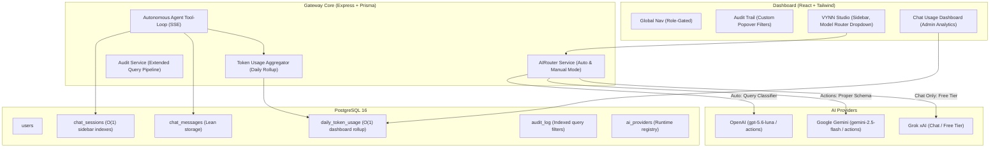

# MCP Gateway v2 — Implementation & Architecture Plan

> **Document:** `plan.v2.md`  
> **Target Version:** Gateway v2.0 & Dashboard v2.0  
> **Brand Identity:** VYNN Autonomous AI Assistant  
> **Scope:** Multi-Provider AI Routing, Chat Persistence & Token Usage Analytics, Complete RBAC UI Enforcement, Advanced Audit Trail Telemetry.

---

## 1. High-Level Architecture & Roadmap



---

## 2. Optimized Database Architecture (Prisma Schema)

### Why the Initial Schema Was Unoptimized
1. **Full-Table Scan on Analytics:** Calculating token metrics with `SUM()` over raw `chat_messages` is an $O(N)$ full-table scan that degrades severely as message history reaches tens of thousands of rows.
2. **Slow Session List Rendering:** Querying session list with dynamic message counts and token joins requires table-locking aggregations.
3. **Payload Bloat:** Storing raw activity JSON inside every message row wastes relational storage on plain text turns.

### The Optimized Schema Design
- **Daily Rollup Table (`daily_token_usage`):** An atomic $O(1)$ upsert table aggregated by `(userId, provider, model, date)`. Admin usage dashboard loads in milliseconds even with millions of chat messages.
- **Denormalized Session Metadata:** `chat_sessions` holds `total_tokens`, `message_count`, and a compound descending index `@@index([userId, updatedAt(sort: Desc)])` for instant sidebar pagination.
- **Lean Messages Table:** Messages store strict enums, indexed by `[sessionId, createdAt(sort: Asc)]`.

```prisma
datasource db {
  provider = "postgresql"
  url      = env("DATABASE_URL")
}

generator client {
  provider = "prisma-client-js"
}

enum Role {
  admin
  member
}

enum ServerStatus {
  connected
  unreachable
  disabled
}

enum MessageRole {
  user
  assistant
  system
  tool
}

model User {
  id            String    @id @default(uuid())
  email         String    @unique
  name          String
  role          Role      @default(member)
  passwordHash  String    @map("password_hash")
  createdAt     DateTime  @default(now()) @map("created_at")

  apiKeys       ApiKey[]
  auditLogs     AuditLog[]
  chatSessions  ChatSession[]
  dailyUsage    DailyTokenUsage[]

  @@map("users")
}

model ApiKey {
  id          String    @id @default(uuid())
  userId      String    @map("user_id")
  name        String
  keyPrefix   String    @map("key_prefix")
  keyHash     String    @unique @map("key_hash")
  revokedAt   DateTime? @map("revoked_at")
  createdAt   DateTime  @default(now()) @map("created_at")

  user        User      @relation(fields: [userId], references: [id], onDelete: Cascade)

  @@index([keyHash])
  @@map("api_keys")
}

model McpServer {
  id                        String        @id @default(uuid())
  name                      String
  slug                      String        @unique
  url                       String
  credentialHeader          String?       @default("Authorization") @map("credential_header")
  credentialValueEncrypted  String?       @map("credential_value_encrypted")
  enabled                   Boolean       @default(true)
  status                    ServerStatus  @default(connected)
  createdAt                 DateTime      @default(now()) @map("created_at")

  auditLogs                 AuditLog[]

  @@map("mcp_servers")
}

model AuditLog {
  id           String     @id @default(uuid())
  userId       String?    @map("user_id")
  serverId     String?    @map("server_id")
  toolName     String     @map("tool_name")
  inputSummary Json       @map("input_summary")
  calledAt     DateTime   @default(now()) @map("called_at")
  durationMs   Int        @map("duration_ms")
  success      Boolean
  errorMsg     String?    @map("error_msg")

  user         User?      @relation(fields: [userId], references: [id], onDelete: SetNull)
  server       McpServer? @relation(fields: [serverId], references: [id], onDelete: SetNull)

  @@index([calledAt(sort: Desc)])
  @@index([userId, calledAt(sort: Desc)])
  @@index([serverId, calledAt(sort: Desc)])
  @@index([success, calledAt(sort: Desc)])
  @@map("audit_log")
}

// ==========================================
// OPTIMIZED CHAT PERSISTENCE & ANALYTICS
// ==========================================

model ChatSession {
  id           String        @id @default(uuid())
  userId       String        @map("user_id")
  title        String        @default("New Conversation")
  provider     String?       // "openai", "gemini", "grok"
  totalTokens  Int           @default(0) @map("total_tokens")
  messageCount Int           @default(0) @map("message_count")
  pinned       Boolean       @default(false)
  createdAt    DateTime      @default(now()) @map("created_at")
  updatedAt    DateTime      @updatedAt @map("updated_at")

  user         User          @relation(fields: [userId], references: [id], onDelete: Cascade)
  messages     ChatMessage[]

  @@index([userId, updatedAt(sort: Desc)])
  @@map("chat_sessions")
}

model ChatMessage {
  id               String       @id @default(uuid())
  sessionId        String       @map("session_id")
  role             MessageRole
  content          String       @db.Text
  provider         String?
  model            String?
  promptTokens     Int?         @map("prompt_tokens")
  completionTokens Int?         @map("completion_tokens")
  totalTokens      Int?         @map("total_tokens")
  activities       Json?        // Stores structured timeline only for assistant turns
  createdAt        DateTime     @default(now()) @map("created_at")

  session          ChatSession  @relation(fields: [sessionId], references: [id], onDelete: Cascade)

  @@index([sessionId, createdAt(sort: Asc)])
  @@map("chat_messages")
}

// High-speed O(1) analytics rollup
model DailyTokenUsage {
  id               String   @id @default(uuid())
  userId           String   @map("user_id")
  provider         String   // "openai", "gemini", "grok"
  model            String
  date             DateTime @db.Date // YYYY-MM-DD bucket
  promptTokens     Int      @default(0) @map("prompt_tokens")
  completionTokens Int      @default(0) @map("completion_tokens")
  totalTokens      Int      @default(0) @map("total_tokens")
  requestCount     Int      @default(0) @map("request_count")

  user             User     @relation(fields: [userId], references: [id], onDelete: Cascade)

  @@unique([userId, provider, model, date])
  @@index([date])
  @@index([userId, date])
  @@map("daily_token_usage")
}

// Runtime AI provider configuration
model AiProvider {
  id            String   @id @default(uuid())
  name          String   @unique          // "openai", "gemini", "grok"
  displayName   String   @map("display_name")
  baseUrl       String   @map("base_url")
  apiKeyEnv     String   @map("api_key_env")
  defaultModel  String   @map("default_model")
  supportsTools Boolean  @default(true) @map("supports_tools")
  costTier      String   @default("paid") @map("cost_tier") // "free", "cheap", "standard"
  enabled       Boolean  @default(true)
  createdAt     DateTime @default(now()) @map("created_at")

  @@map("ai_providers")
}
```

---

## 3. Feature Breakdown & Implementation Details

### Feature 1: Multi-Provider AI Model Routing
1. **Providers Seed:**
   - `openai`: `gpt-5.6-luna` (cheapest paid tier, schema-compliant tool calls).
   - `gemini`: `gemini-2.5-flash` (high-capacity, complex multi-step reasoning & tool calling).
   - `grok`: `grok-3-mini` / open models (free tier for conversation & pure Q&A, `supportsTools: false`).
2. **Intelligent Router (`AIRouter`):**
   - **Auto Mode:** Evaluates user prompt against available tools. Sends query intent to `gpt-5.6-luna` for lightweight classifier response `{"provider": "...", "reason": "..."}`.
   - If action/tool required $\rightarrow$ routes to OpenAI or Gemini.
   - If conversational $\rightarrow$ routes to Grok (zero cost).
   - **Manual Mode:** User selects provider directly from the composer dock.

### Feature 2: Chat Persistence & Token Usage Analytics
1. **User Chat Experience:**
   - Collapsible Chat History sidebar grouped by `Today`, `Yesterday`, `Past 7 Days`.
   - Title auto-generated from initial prompt (first 80 chars, word-boundary clean).
   - Instant hydration of historical messages and execution timelines.
2. **Admin Token & Cost Analytics:**
   - Tab / sub-view in Team Management: Per-member breakdown of prompt tokens, completion tokens, requests, and estimated costs per provider.
   - Admin click-through to inspect member chat transcripts (read-only audit view).

### Feature 3: RBAC UI Enforcement
1. **Navbar:** Team tab strictly hidden from `member` users.
2. **Servers View:** Upstream toggle switches and edit actions hidden for members; replaced with read-only badge.
3. **App-Level Router Guard:** Non-admin attempts to access admin tabs trigger seamless redirect to `/servers`.

### Feature 4: Audit Trail Telemetry & Custom Kumo Filters
1. **Custom UI Components (No Default HTML):**
   - Bespoke Custom Select dropdown with subtle dark borders, search filter, and custom checkmarks.
   - Popover Date-Range Picker with quick range pills (`Today`, `Last 24h`, `Last 7 Days`, `Last 30 Days`, `Custom Range`) instead of raw native browser date pickers.
2. **Backend Query Engine:** Multi-field filtering on `userId`, `serverId`, `success`, `startDate`, `endDate`, and case-insensitive search across tool names and error traces.

---

## 4. Execution Sequence

1. **Step 1:** Push `plan.v2.md` to GitHub repository.
2. **Step 2:** Refactor `AuditLogView.tsx` with custom, non-native styled filter components (Kumo dark aesthetic).
3. **Step 3:** Apply optimized Prisma database schema update and generate migration.
4. **Step 4:** Implement `apps/gateway/src/services/aiRouter.ts` and token tracking in `chat.ts`.
5. **Step 5:** Build Chat History sidebar & Admin Token Analytics dashboard.
6. **Step 6:** Validate full cluster deployment with zero-downtime Helm rollout.
